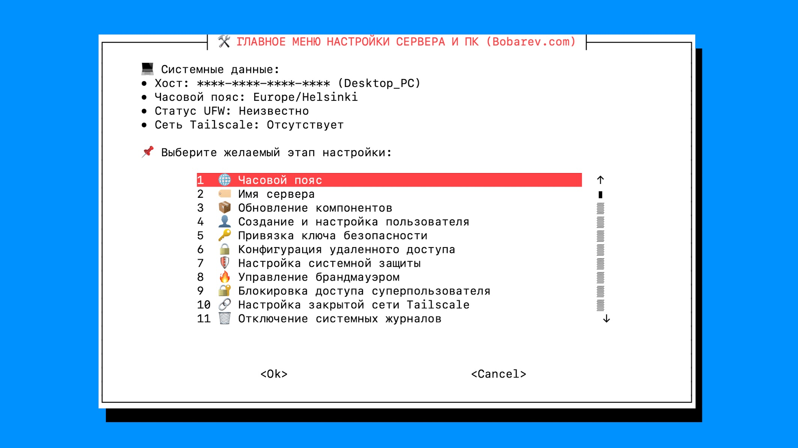

# 🛠️ Bobarev Shell (v3.8.55 Professional Stealth & Audit Suite)

Универсальный скрипт комплексной настройки Linux-серверов (VPS) «с нуля» до боевого запуска, а также оптимизации домашних ПК и одноплатных микрокомпьютеров (SBC: NanoPi, Raspberry Pi, Orange Pi).

Включает модули сквозного каскадирования трафика в обход ТСПУ, высокопроизводительный сетевой профиль **Zero-Bufferbloat & High-Throughput Engine**, личный ретранслятор DERP, встроенную защиту от оверселлинга хостинга и двухфакторный аудит сетевых пар.

Рекомендованные площадки: | [VPS 1](https://apt.bobarev.com) | [VPS 2](https://apt2.bobarev.com) |

---

### 🚀 Быстрый запуск в одну команду

Запустите команду от имени `root` в терминале вашего сервера или ПК:

```bash
bash <(curl -sSL https://raw.githubusercontent.com/michaelbobarev/bobarev_shell/main/bobarev_shell.sh)
```

*(Доступен запуск с аргументами: `--audit` / `-a` — экспресс-аудит системы, `--net-audit` / `-n` — диагностика сети и каскадных пар, `--backup` / `-b` — бэкап настроек, `--auto` — полная автонастройка шагов 1–12).*

---

### 📸 Меню управления



---

## 📋 Список модулей и возможностей

### 🌐 1. Базовая система, безопасность и ядро

* **01. Часовой пояс и время** — установка локального часового пояса и точная синхронизация по NTP (`systemd-timesyncd`).
* **02. Имя сервера (Hostname)** — смена имени хоста с автоматической привязкой в `/etc/hosts` и защитой от перезаписи cloud-init.
* **03. Обновление пакетов и zRAM** — приоритет IPv4 в `gai.conf` (защита от зависаний apt/curl), настройка автообновлений безопасности (`unattended-upgrades`) и сжатие оперативной памяти **zRAM (алгоритм zstd, 50% RAM)**.
* **04. Пользователь и Sudo** — создание непривилегированного администратора с паролем и изолированным правилом `NOPASSWD` с наивысшим приоритетом (`/etc/sudoers.d/99-zzz-*`).
* **05. Привязка SSH-ключей** — быстрое добавление публичных ключей (ed25519/rsa) с жесткой фиксацией прав доступа `chmod 700/600`.
* **06. Безопасность удаленного доступа (SSH)** — смена порта, запрет прямого входа root, отключение паролей и **полная Zero-Trust изоляция** (доступ к порту SSH разрешен строго внутри закрытой сети). Подключение легковесного бана брутфорса `sshguard`.
* **07. Защита ядра и сетевой стек** — активация **TCP BBR + FQ qdisc**, расширение буферов сокетов до 64–128 МБ, защита от SYN-флуда, скрытие сервера от ICMP-пингов, включение IPv4/IPv6 форвардинга и таймер аппаратного сторожевого таймера Watchdog (15s) для мини-ПК.
* **08. Брандмауэр UFW и защита Docker** — изоляция портов, автоконфигурация маршрутизации трафика (NAT/MASQUERADE/SNAT для масок /32), запрет внешнего обхода файрвола контейнерами Docker (`DOCKER-USER`) и MSS Clamping.
* **09. Блокировка Root** — безопасная блокировка учетной записи суперпользователя (`passwd -l root`) при наличии настроенного sudo-администратора.

---

### 🔗 2. Меш-сети, личный DERP и локальный роутер

* **10. Закрытая меш-сеть Tailscale**:
  * Быстрая авторизация по Auth-Key или ссылке;
  * Режим сетевого шлюза (`Exit-Node`) с автоматической трансляцией NAT и защитой от конфликтов подсетей;
  * Трансляция локальных LAN-подсетей (`Subnet Router`) и прием маршрутов;
  * Стелс-режим (Stateful Filtering) и аппаратное ускорение UDP GRO;
  * Локальный браузерный веб-интерфейс (порт 5252);
  * Переключение приоритета сетевых фильтров: UFW (системный) <-> Tailscale;
  * **Личный ретранслятор DERP**: компиляция `derper` из исходников Go, связка с SSL-сертификатами Cloudflare Origin CA на порту 443, встроенный STUN-сервер (порт 3478) и готовый генератор JSON-блока `derpMap` для ACL-панели Tailscale.
* **17. Режим локального маршрутизатора (SBC Router)** — трансформация микрокомпьютера (NanoPi R5C / Raspberry Pi) в аппаратный сетевой шлюз для роутеров (например, Google Wi-Fi): выбор входного LAN-интерфейса, выходного канала (WireGuard `wg0`, `wg-cascade`, `warp`, `tailscale0` или WAN), статический IP и защита от утечки трафика (Kill Switch).
* **18. Экспорт и импорт настроек (Backup Manager)** — создание полного сжатого архива всех сетевых служб, скриптов маршрутизации, конфигураций UFW, Caddy, Xray, WireGuard и сертификатов в единый `.tar.gz` для мгновенного переноса сервера.

---

### 🚀 3. Скоростные каскады обхода блокировок ТСПУ

Схема каскада: **Клиент (Shadowrocket) ➔ Входной сервер (РФ, NaiveProxy Caddy 2) ➔ Защищенный мост ➔ Зарубежный сервер ➔ Выход (Чистый IP / Cloudflare WARP)**.

Скрипт автоматически компилирует Caddy с модулем `forwardproxy@naive`, генерирует беспарольные/парольные ссылки Shadowrocket с поддержкой жесткого протокола `http2://` в один клик и маскирует веб-интерфейс камуфляжным сайтом DevStack.

* **19. Каскад 1: NaiveProxy ➔ WireGuard + udp2raw ➔ WARP / Прямой выход**:
  * Прямой ядерный туннель между серверами с MTU 1280 и MSS 1240;
  * Встроенная побитовая маскировка заголовков **udp2raw** (режимы `FakeTCP` или `UDP-XOR`) для обхода шейпинга ТСПУ;
  * Генерация независимых токенов для одновременного подключения до 3 российских серверов к одному зарубежному шлюзу.
* **20. Каскад 2: NaiveProxy ➔ Hysteria 2 ➔ WARP / Прямой выход**:
  * Скоростной мост на протоколе QUIC (UDP) с агрессивным контролем перегрузок BBRv3;
  * Встроенный самоподписанный TLS-сертификат и SNI-камуфляж;
  * Локальный SOCKS5-мост `127.0.0.1:1080` и передача настроек через закодированный токен.
* **21. Каскад 3: NaiveProxy ➔ Xray (VLESS REALITY) ➔ WARP / Прямой выход**:
  * Полная имитация легитимного TLS 1.3 рукопожатия к доверенным зарубежным ресурсам (`gateway.icloud.com`);
  * Клиентский модуль фрагментации пакетов TCP (`dialerProxy: fragment`) для преодоления DPI-блокировок;
  * Проксирование через локальный сокет `127.0.0.1:10808`.

---

### ⚡ 4. Сетевой движок Zero-Bufferbloat (v3.8.55 Tuning Engine)

Каскады и сетевой стек сервера оптимизированы под каналы 1 Гбит/с+:
* `net.ipv4.tcp_notsent_lowat = 16384` — предотвращает накопление мегабайтных очередей в `Send-Q` сокетов Caddy/Xray, снижая задержку первого байта (TTFB) и ликвидируя bufferbloat;
* `net.ipv4.tcp_slow_start_after_idle = 0` — сохраняет максимальное окно BBR при кратковременных паузах в потоковом видео (YouTube 4K, стриминг);
* `net.ipv4.tcp_mtu_probing = 1` и `tcp_base_mss = 1024` — динамический подбор MSS без разрыва сессий и дропов пакетов;
* `flush_interval -1` в Caddyfile — потоковая отдача видеочанков без промежуточной буферизации;
* Расширенные кольцевые буферы интерфейсов и оптимизация очередей `fq` (`limit 30000`).

---

### 🔍 5. Интеллектуальная диагностика и аудит

* **22. Аудит системы 1 (Интеллектуальный срез железа и оверселлинга)**:
  * Проверка состояния BBR, буферов сокетов, правил фаервола и Zero-Trust изоляции;
  * **Детектор оверселлинга хостинга**: измерение CPU Steal под реальной нагрузкой, замер вычислительной задержки ядра (троттлинг), прямой тест физического отклика диска (латентность в миллисекундах и реальные IOPS) и анализ очередей ожидания PSI (Pressure Stall Information).
* **23. Аудит системы 2 и каскадные пары (`network-audit v3.1`)**:
  * **Режим 1 (Срез постфактум)**: детальный разбор запущенных туннелей, сокетов `ss -tinpe`, conntrack и накопительных счетчиков стека с записью 15-секундного дампа пакетов;
  * **Режим 2 (Активный тест пары)**: пошаговое тестирование связки РФ <-> Зарубеж (поиск точного Path MTU без фрагментации, TCP MSS, трассировка MTR, аудит доступности TCP/UDP портов и iperf3);
  * **Режим 3 (Мониторинг Live / «Черный ящик»)**: непрерывная запись движения пакетов, динамики RTT, CWND и ретрансмитов под нагрузкой. **Полная отказоустойчивость**: протокол надежно сохраняется при остановке по кнопке Enter / Ctrl+C, а также при аварийном обрыве SSH-сессии.

---

### 💾 6. Оптимизация накопителей и ПК

* **11. Управление журналами** — ограничение объема логов `journald` (100 МБ / пользовательский размер) либо полный режим Stealth (Storage=none, отключение rsyslog/auditd для защиты SSD/MicroSD от износа).
* **12. Оптимизация памяти и дисков** — параметры монтирования `noatime`, буферизация `commit=120`, перенос `/tmp` и `/var/tmp` в `tmpfs`, планировщики ввода-вывода `mq-deadline` (Flash) / `none` (NVMe).
* **13. Управление Swap** — быстрое выделение, настройка zRAM-swap или удаление файла подкачки.
* **14. Режимы CPU и рабочий стол** — переключение регуляторов частоты процессора (`Performance`, `Ondemand`, `Powersave`) и автозапуск системных апплетов трея для графических сред.
* **15–16. Диагностика загрузки и видеовыход** — сброс HDMI через `xrandr` и построение SVG-графиков скорости загрузки (`systemd-analyze plot`).

---

## 👤 Автор

**Michael Bobarev**  
Веб-сайт: [https://www.bobarev.com](https://www.bobarev.com)
