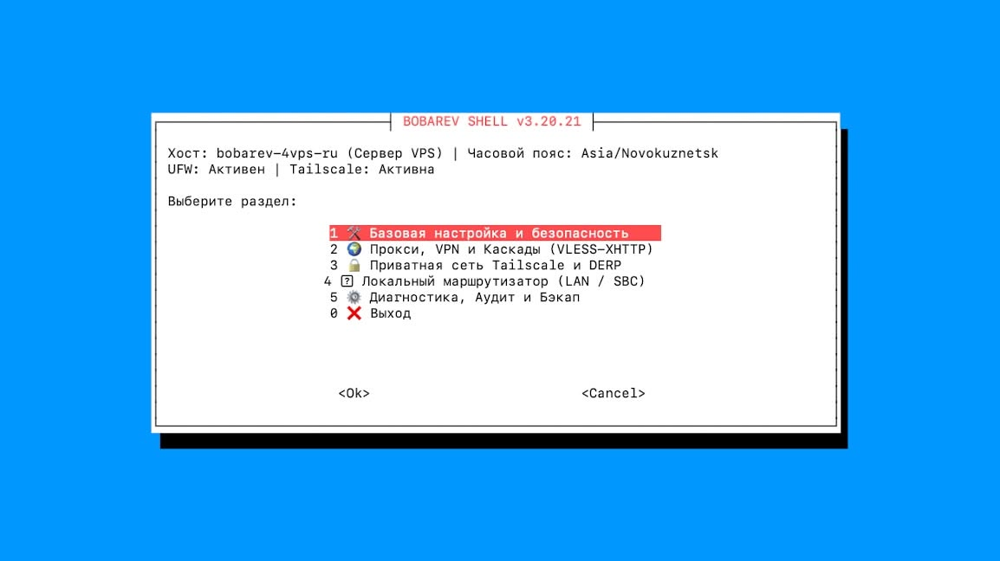

🛠️ Bobarev Shell (v3.20.21 — Linux Server Optimization, Mesh Networking & Audit Suite)

Интерактивная модульная система на Bash для быстрой настройки, защиты и сетевой оптимизации Linux-серверов (Debian 12/13, Ubuntu), домашних ПК и одноплатных микрокомпьютеров (Armbian, NanoPi R5C, Raspberry Pi, Orange Pi) «с нуля» до готовой инфраструктуры.

Включает профиль ядра **Zero-Bufferbloat & High-Throughput Engine** (TCP BBR, FQ, буферы 16 МБ), управление приватными mesh-сетями [Tailscale](https://tailscale.com) и собственными ретрансляторами DERP, гибкую маршрутизацию трафика через современные протоколы транспорта ([Xray-core](https://github.com/XTLS/Xray-core) XHTTP, [Hysteria 2](https://v2.hysteria.network) QUIC, [WireGuard](https://www.wireguard.com), [Usque](https://github.com/Diniboy1123/usque) MASQUE), а также комплексный аудит безопасности и производительности хостинга.

Рекомендованные площадки: **[VPS / VDS](https://apt.bobarev.com)**

## 🚀 Быстрый запуск в одну команду

Запустите скрипт от имени `root` в терминале вашего сервера или мини-ПК:

```bash
bash <(curl -sSL https://raw.githubusercontent.com/michaelbobarev/bobarev_shell/main/bobarev_shell.sh)
```

Доступны ключи командной строки для автоматизации и быстрой диагностики:

```bash
./bobarev_shell.sh --auto        # Автоматическая базовая настройка и защита сервера
./bobarev_shell.sh --audit       # Комплексный аудит безопасности, ядра и ресурсов VPS
./bobarev_shell.sh --net-audit   # Диагностика сетевого стека, MTU/MSS и маршрутов
./bobarev_shell.sh --backup      # Экспорт или восстановление всех настроек в один архив
./bobarev_shell.sh --update      # Безопасное обновление пакетов и очистка системы
```

---

### 📸 Меню управления



---

## 📋 Архитектура меню и возможности

| Раздел меню | Назначение и ключевые компоненты |
| :--- | :--- |
| **1. 🛠 Базовая настройка и безопасность** | Подготовка ОС, SSH Zero-Trust, защита от брутфорса (`sshguard` / `fail2ban`), UFW, тюнинг ядра BBR + FQ, zRAM (`zstd`), оптимизация SSD/SD-карт и пакетный режим `A` |
| **2. 🌍 Прокси, VPN и Каскады** | 4 сценария с единым глобальным профилем VLESS-XHTTP (TLS 1.3): автономный сервер (`Чистый IP` / `MASQUE` / `WireGuard wg0`), двухсерверные мосты XHTTP и Hysteria 2 QUIC, а также шлюз и каскад [Tailscale](https://tailscale.com) / Mullvad |
| **3. 🔒 Приватная сеть Tailscale и DERP** | Управление узлами Tailnet, Exit Node, Subnet Router, аппаратное ускорение UDP GRO, локальная веб-панель и развертывание собственного сервера DERP + STUN |
| **4. 🖧 Локальный маршрутизатор (LAN / SBC)** | Превращение одноплатного компьютера (NanoPi R5C / Raspberry Pi) в домашний сетевой шлюз с DHCP/DNS (`dnsmasq`), Policy Routing, MSS Clamping и защитой маршрута |
| **5. ⚙️ Диагностика, Аудит и Бэкап** | Детектор оверселлинга хостинга (CPU Steal, IOPS диска, PSI), проверка безопасности, 3-режимный сетевой анализатор, управление логами и перенос конфигураций |

## 🛠 1. Базовая настройка, безопасность и оптимизация ОС

* **Система, время и пакеты (п. 1–3)** — синхронизация точного времени по NTP (`systemd-timesyncd`), настройка имени хоста с защитой от перезаписи `cloud-init`, автообновления безопасности (`unattended-upgrades`) и служба сохранения нативного Dual-Stack (`IPv4 + IPv6`) и DNS после перезагрузки.
* **Администратор, SSH и защита от перебора (п. 4–7)** — создание пользователя с изолированным правилом `sudo`, добавление ключей `ed25519`/`rsa`, перенос SSH на нестандартный порт, отключение парольного входа, изоляция управления внутри приватной сети Tailscale и автоматическая защита от подбора паролей (`sshguard` и `fail2ban`).
* **Профиль ядра и сетевой стек (п. 8)** — включение алгоритма управления перегрузками **TCP BBR + планировщика FQ**, сбалансированных буферов сокетов (`16 МБ`), `tcp_notsent_lowat = 16384` для минимального отклика (Zero-Bufferbloat), `tcp_mtu_probing`, IPv4/IPv6-форвардинга и аппаратного таймера Watchdog для мини-ПК.
* **Межсетевой экран UFW и изоляция Docker (п. 9–10)** — автоматическая настройка правил маршрутизации (NAT / MASQUERADE / SNAT), двусторонний зажим `TCPMSS`, защита цепочки `DOCKER-USER` и безопасная блокировка прямого входа `root`.
* **Память, накопители и энергопотребление (п. 11–14)** — сжатие оперативной памяти **zRAM (`zstd`, до 50% RAM)**, управление файлом подкачки Swap, снижение износа флеш-памяти и SSD (`noatime`, `commit=120`, перенос `/tmp` в `tmpfs`, планировщики `mq-deadline` / `none`) и выбор профилей частоты CPU.

## 🌍 2. Сетевые туннели, VPN и многоузловая маршрутизация

Все 4 топологии раздела используют **единый глобальный профиль учетной записи**: создав клиентские ссылки и QR-коды один раз, вы можете свободно переключать выходные серверы, менять транспорт (`IPv4 + IPv6`, `Только IPv4` или `Только IPv6`) и переходить между режимами без перенастройки клиентских устройств.

* **Автономный сервер: VLESS-XHTTP (п. 1)** — единая панель управления одиночным VPS на базе [Xray-core](https://github.com/XTLS/Xray-core) (`VLESS-XHTTP` / TLS 1.3 + опционально [Hysteria 2](https://v2.hysteria.network) QUIC на UDP-порту) с мгновенным переключением между тремя режимами выхода в интернет без смены клиентских ключей:
  * **Чистый IP самого VPS** — прямой выход в интернет с максимальной пропускной способностью (Dual-Stack `IPv4 + IPv6`);
  * **Cloudflare MASQUE** — маршрутизация через клиент [Usque](https://github.com/Diniboy1123/usque) (`l4-socks` / `socks`) и сеть Cloudflare CDN;
  * **Внешний туннель [WireGuard](https://www.wireguard.com) (`wg0`)** — маршрутизация через любой внешний конфиг WireGuard в режиме Dual-Gateway с полным сохранением связности Tailscale.
* **Двухузловая маршрутизация XHTTP (п. 2)** — объединение входного и выходного VPS в единую цепочку по протоколу HTTP/2 (`stream-one`) с переносом параметров подключения через компактный токен и горячей сменой выходного сервера в один шаг.
* **Двухузловая маршрутизация на базе [Hysteria 2](https://v2.hysteria.network) QUIC (п. 3)** — высокоскоростной UDP-мост между серверами с проверкой отпечатка сертификата `pinSHA256`, адаптивным управлением полосой пропускания и поддержкой резервных портов.
* **Единый шлюз и каскад [Tailscale](https://tailscale.com) / Mullvad (п. 4)** — универсальное решение как для одного VPS с выходом через узлы Mullvad Exit Node, так и для связки из двух собственных серверов в сети Tailnet:
  * Выпадающий интерактивный список всех доступных выходных узлов (Mullvad и личные серверы) с переключением по нажатию `Enter`;
  * Сквозная поддержка **Dual-Stack (`IPv4 + IPv6`)**, точное согласование `MTU 1280` и двусторонний `TCPMSS 1220` на интерфейсе `tailscale0`;
  * Выбор протокола транспорта между узлами (`41641/udp`: `IPv4+IPv6`, `Только IPv4` или `Только IPv6`) и мгновенное переключение выхода второго сервера между чистым IP и Cloudflare MASQUE.

## 🔒 3. Приватная сеть Tailscale и собственный сервер DERP

* **Автоматическая конфигурация [Tailscale](https://tailscale.com)** — подключение по Auth-Key или интерактивной ссылке, включение режима выходного узла (`Exit Node`) и маршрутизатора локальных подсетей (`Subnet Router`).
* **Аппаратное ускорение и фильтрация** — настройка `ethtool` (`rx-udp-gro-forwarding`) для гигабитной пропускной способности туннеля `tailscale0`, встроенный веб-интерфейс управления и согласование приоритетов с системным файрволом UFW.
* **Собственный ретранслятор DERP + STUN** — автоматическая сборка `derper` из актуальных исходников Go, привязка сертификатов TLS на порту `443`, запуск STUN на `3478/udp` и генерация готового JSON-фрагмента `derpMap` для панели управления Tailscale.

## 🖧 4. Аппаратный локальный маршрутизатор (LAN / SBC)

* **Домашний шлюз на базе одноплатного ПК** — превращает NanoPi R5C, Raspberry Pi или мини-ПК с двумя сетевыми картами в прозрачный маршрутизатор для домашней сети или точки доступа Wi-Fi.
* **Интеллектуальная маршрутизация и отказоустойчивость** — раздача адресов по DHCP и кеширующий DNS (`dnsmasq`), автоматическое восстановление выбранного выходного узла после перезагрузки, аппаратный `TCPMSS Clamping` и защита от утечки трафика мимо активного туннеля.

## ⚙️ 5. Диагностика, аудит хостинга и резервное копирование

* **Аудит состояния сервера и безопасности (п. 1)** — проверка соответствия параметров `sysctl`, статуса BBR, синхронизации портов SSH и `fail2ban`, политики паролей PAM (`pwquality`), логов `sudo`, нестандартных SUID-файлов, а также **тест честности ресурсов VPS** (измерение CPU Steal, вычислительного отклика ядра, реальных IOPS / задержки диска и очередей ожидания PSI).
* **Сетевая диагностика и проверка пар серверов (п. 2)** — три режима анализа:
  * **Моментальный срез** — инспекция активных служб, таблиц маршрутизации, правил `conntrack` и сокетов `ss -tinpe`;
  * **Тест связки двух узлов** — определение точного Path MTU без фрагментации, проверка TCP MSS, трассировка MTR и замер пропускной способности;
  * **Мониторинг в реальном времени** — запись динамики RTT, окна перегрузки `cwnd` и счетчиков сетевого стека под нагрузкой с автоматическим сохранением отчета даже при разрыве SSH-сессии.
* **Журналы, загрузка, бэкап и сброс (п. 3–6)** — лимитирование или отключение дисковых логов `journald`, анализ скорости старта служб (`systemd-analyze`), упаковка всех сетевых настроек и ключей в единый архив `.tar.gz` для быстрого переезда на новый сервер и выборочный сброс сетевых надстроек без затрагивания базовой ОС.

## 👤 Автор

**Michael Bobarev**  
Веб-сайт: [https://www.bobarev.com](https://www.bobarev.com)
